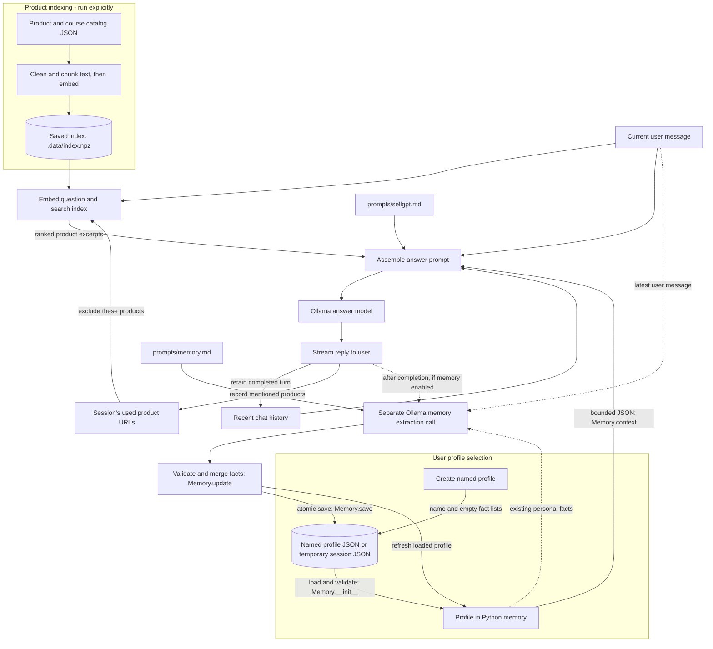

# SellGPT architecture

SellGPT is a local Python application with a Gradio browser interface and a CLI.
It combines a user profile, recent conversation turns, and retrieved product text
to build a prompt for an Ollama language model. Profiles and the product index
are stored in files; chat history stays in session memory.

## Data flow



The indexing step uses Ollama's embedding model. Search uses that same embedding
model; answer generation and memory extraction use the configured answer model.
The profile file in the diagram is the selected named file, or a unique temporary
file when anonymous memory is enabled. Creating a named profile always writes a
persistent file.

## Where profiles are created, loaded, and updated

Each named profile has one file under `rag/user_profiles/`. There is no separate
original profile and learned copy. A newly created profile looks like this:

```json
{
  "name": "Taylor",
  "sex": [],
  "goals": [],
  "preferences": [],
  "weakness": []
}
```

| Operation | Location in the code | What happens |
| --- | --- | --- |
| Discover profiles | `ui.py`: `build_ui()` → `profiles()` | Lists JSON files from `user_profiles/` beside the configuration, plus any configured profile path. |
| Create a profile | UI: `new_user_profile()`; CLI: `--new-user-profile`; both call `memory.py`: `create_user_profile()` | Creates a file with a name and empty fact lists, rejects an existing filename, and enables memory updates. |
| Load a profile | UI: `load_session()`; CLI: `run_cli()`; both construct `Memory(path)` | Reads and validates JSON without writing it. The UI reloads writable profiles before each question; the CLI loads once at startup. |
| Use the profile | `assistant.py`: `prepare_answer()` → `Memory.context()` | Adds a compact JSON representation to the answer prompt. The greeting also receives profile context through `introduce()`. |
| Extract new facts | `memory.py`: `Memory.update()` → `ollama.py`: `extract_memory()` | After a completed answer with memory enabled, sends only the latest user message to a separate model call returning four lists of facts. |
| Merge and save | `memory.py`: `Memory.update()` → `Memory.save()` | Appends distinct facts without deleting old entries, and atomically replaces the same JSON file. The loaded profile is refreshed too. |
| Clear all facts | CLI: `/forget` → `Memory.clear()` | With memory enabled, writes an empty profile, including an empty name, and resets the conversation and product tracking. |

The extractor receives neither the assistant's answer nor RAG excerpts. Its
instructions come from `prompts/memory.md`, read on every update. The profile
name is set at creation or by manual editing; extraction updates the four lists.

Python preserves older facts when extraction omits them. The model only extracts
facts from the latest message; it does not receive saved memory or manage removals.
Corrections are appended as new facts. To change or remove individual saved entries,
edit the profile JSON. `/forget` in the CLI clears the whole profile. Entries are
limited to 120 characters, with no total item cap. Invalid extraction or a failed
save preserves the previous profile and completed reply. Validation checks data
structure; it does not verify the truth of extracted facts.

### Memory modes and session lifetime

| Selection | Memory disabled | Memory enabled |
| --- | --- | --- |
| Named profile | Uses the loaded profile without saving updates. | Uses and updates that profile's JSON file. |
| No profile | Uses no profile context. | Learns into a unique temporary JSON file for the session. |

Memory updates are disabled by default. In the UI, switching profiles clears chat
history and product tracking and discards anonymous memory. Toggling memory keeps
recent turns and product tracking. **Clear chat** and CLI `/reset` retain profile
facts while resetting conversation history and product tracking. Anonymous files
are cleaned up on browser unload/state cleanup or normal CLI exit.

## Where RAG information is used

**RAG retrieves product information for the answer prompt. User profiles do not
participate in vector search.**

1. **Build the index:** `sellgpt index` reads the configured catalogs, currently
   `site_catalog/products_clean.json` and `site_catalog/courses.json`.
   `catalog.py` deduplicates entries by URL across both files, strips HTML, and chunks
   descriptions, summaries, audiences, suggested use, categories, and filtered tags,
   prefixing each chunk with the
   product name. Current settings use 250-word chunks with 40 words of overlap.
   Tag filtering removes internal and promotional labels, normalizes and
   deduplicates tags, and keeps at most 12 short tags per entry.
   `index.py` embeds and normalizes them, then saves vectors, chunk text, URLs,
   and compatibility metadata in `.data/index.npz`.
2. **Retrieve on each question:** `Index.search()` embeds only the current user
   message and ranks catalog vectors by cosine similarity using NumPy. It returns
   up to five chunks with at most two per product. Products already mentioned in
   completed replies are excluded using the session's used-URL set.
3. **Build the generation context:** `prepare_answer()` combines the assistant
   prompt, bounded profile JSON, recent history, numbered product excerpts, and
   current question. Context limits can reduce the retained history, number of
   sources, or excerpt lengths. The profile context targets a 600-byte budget;
   facts omitted from that context remain stored in the profile.
4. **Generate the answer:** `Ollama.chat()` streams the response. The browser uses
   the retrieved names and URLs to turn product mentions and citations into links.
   A separate session lookup keeps earlier product names linkable. Python records
   which retrieved products were mentioned for later retrieval filtering.

For example, “What could help my evening routine?” searches the catalog using that
message. A saved preference for short routines can shape the generated answer,
but it does not change the search query. History also influences generation
without being appended to the retrieval query.

Greetings use the assistant prompt and optional profile, without retrieval or
memory updates. CLI `search` performs retrieval alone; `ask` and `chat` generate
answers and optionally update memory. This process supplies context to existing
models; it does not train them.

## Code map and configuration

| File | Responsibility |
| --- | --- |
| [ui.py](src/sellgpt/ui.py) / [cli.py](src/sellgpt/cli.py) | Entry points, session lifecycle, profile selection, and user actions. |
| [assistant.py](src/sellgpt/assistant.py) | Greetings, answer prompt assembly, context budgeting, and CLI answer flow. |
| [memory.py](src/sellgpt/memory.py) | Profile creation, loading, validation, merging, and atomic saving. |
| [catalog.py](src/sellgpt/catalog.py) / [index.py](src/sellgpt/index.py) | Product preparation, index construction, compatibility checks, and retrieval. |
| [ollama.py](src/sellgpt/ollama.py) | HTTP requests for embeddings, streamed answers, and JSON memory extraction. |
| [products.py](src/sellgpt/products.py) | Product mention matching and used-URL detection without model calls. |
| [config.py](src/sellgpt/config.py) / [config.toml](config.toml) | Settings and path resolution relative to the configuration file. |

The checked-in configuration currently selects `embeddinggemma:300m` for
embeddings and `s1gnature/qwen3.5-uncensored:4b-q8_0` for answers and memory
extraction, with an 8,192-token context and 512-token answer output limit. Both
interfaces use Ollama at `http://127.0.0.1:11434` by default.

Assistant behavior and fact selection depend on the editable prompts; Python
enforces the data flow and profile validation. There is no relevance threshold
or reranker. Changing the catalog, embedding model, or chunk settings requires
an index rebuild. Profile and prompt changes do not. The UI serializes actions,
but profile files have no cross-process write lock, so use one writer per profile.
